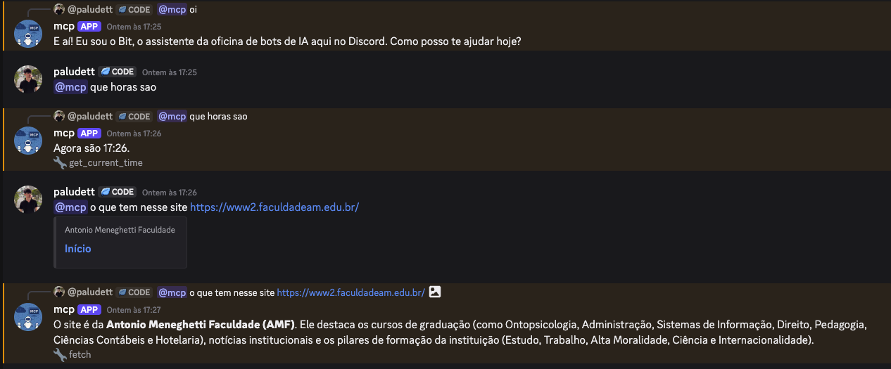
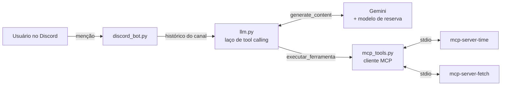

# Bit — bot de Discord com Gemini e MCP

Assistente de Discord que usa **tool calling via MCP (Model Context Protocol)**:
em vez de eu escrever as funções das ferramentas na mão, o bot sobe servidores
MCP prontos, descobre as ferramentas deles em tempo de execução e entrega para o
Gemini decidir quando usar cada uma.

> Este projeto é um extra que construí sozinho para o encerramento da oficina
> **"Chatbot de IA no Discord com Python"**, dada na **AMF** para alunos de
> Sistemas de Informação. Ele mostra o passo seguinte ao chatbot básico da aula.
> O repositório da oficina, ponto de partida deste, está em
> [stfl-guilherme/Oficina_Chat_Bot_Discord](https://github.com/stfl-guilherme/Oficina_Chat_Bot_Discord).
>
> Oficina ministrada por [Guilherme Stefanello](https://github.com/stfl-guilherme),
> [Murilo Muller](https://github.com/Muller-SR),
> [Luiz Alawi](https://github.com/luiz-alawi) e eu.



## O que demonstra

- **Cliente MCP em Python:** dois servidores rodando como subprocessos (stdio),
  gerenciados por um `AsyncExitStack` que os encerra junto com o bot.
- **Descoberta dinâmica de ferramentas:** o bot chama `list_tools()` e converte o
  JSON Schema de cada ferramenta em `FunctionDeclaration` do Gemini. Adicionar um
  servidor novo é incluir uma linha em `SERVIDORES_MCP`.
- **Laço de tool calling:** o modelo pede ferramentas, o bot executa via MCP e
  devolve o resultado, com limite de chamadas por pergunta (`MAX_CHAMADAS_TOOL`).
- **Resiliência:** retry com backoff exponencial em erros transitórios (429 e
  5xx) e troca automática para um modelo de reserva.
- **Transparência:** cada resposta mostra no rodapé as ferramentas usadas.
- **Segurança:** só ferramentas de leitura, e o `system_instruction` instrui o
  modelo a tratar páginas baixadas como dado, não como ordem (veja
  [Segurança](#segurança)).

## Ferramentas MCP

| Servidor | Ferramentas | Para quê |
|---|---|---|
| `mcp-server-time` | `get_current_time`, `convert_time` | hora atual e fusos horários |
| `mcp-server-fetch` | `fetch` | baixar uma página e ler o conteúdo |

## Arquitetura



| Arquivo | Responsabilidade |
|---|---|
| `bot.py` | ponto de entrada: conecta os servidores MCP e inicia o bot |
| `config.py` | variáveis de ambiente, limites, prompt do sistema e servidores MCP |
| `discord_bot.py` | eventos do Discord, cooldown por usuário e histórico por canal |
| `llm.py` | chamadas ao Gemini com retry e o laço de tool calling |
| `mcp_tools.py` | conexão com os servidores MCP e execução das ferramentas |

## Rodando no seu PC

```bash
python3 -m venv .venv
source .venv/bin/activate        # Windows: .venv\Scripts\Activate.ps1
pip install -r requirements.txt
cp .env.example .env             # Windows: Copy-Item .env.example .env
python bot.py
```

Preencha `DISCORD_TOKEN` e `GEMINI_API_KEY` no `.env`. Deu certo quando aparecer
`Online como ...`. No Developer Portal, o bot precisa da **Message Content
Intent** ligada.

## Exemplos de uso

- `@bot que horas são agora?`: sem a ferramenta, o modelo não tem como saber.
- `@bot quando for 19h aqui, que horas vão ser em Lisboa e em Tóquio?`
- `@bot resume essa página: <link>`

## Deploy no Railway

1. No projeto do Railway: **+ Create → GitHub Repo** → este repositório.
   O `railway.toml` já manda usar o Dockerfile.
2. Em **Variables**: `DISCORD_TOKEN` e `GEMINI_API_KEY`.
3. Não precisa de domínio público, porta nem volume.

## Segurança

O texto de uma página baixada pode tentar dar ordens ao modelo (*prompt
injection*). O `system_instruction` avisa para não obedecer, mas isso reduz o
risco sem eliminar. Por isso o bot só tem ferramentas de leitura.

## Notas

- **robots.txt:** o Fetch respeita o robots.txt, então alguns sites recusam.
- **Fuso:** o container roda em UTC; o fuso local vem de `FUSO_HORARIO`.
- **Node.js é opcional:** sem ele, o Fetch extrai o texto em modo Python puro e
  só imprime um aviso no log.

## Stack

Python 3.12 · discord.py · google-genai (Gemini) · mcp · Docker · Railway

## Licença

[MIT](LICENSE)
